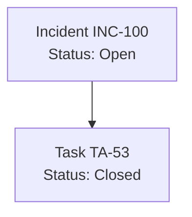

# Plan — MCP-only runtime, plugin slimdown, EDT fix

**Status:** Draft 2026-04-30 · supersedes the daemon split in `PLAN-onboard-cli.md` §4.3
**Backing research:** Exa (onnxruntime providers, single-instance fcntl/msvcrt, claude mcp scopes/reconnect), DeepWiki `jlowin/fastmcp` (lifespan, EventStore, graceful shutdown), HF model card `jinaai/jina-embeddings-v2-base-code`.

---



    
## 1. Problem

Three coupled symptoms surfaced today:

1. **EDT freezes ~19 s.** Status tab fires a 5 s Swing Timer that shells out to `nvidia-smi` and `python -c …` from the EDT. NVML driver-lock contention (TRT engine build, second IDE, GPU under load) blocks the subprocess; EDT sits in `Process.read()`. Stack confirmed at `OneLensToolWindow.kt:117 → SystemMonitor.kt:27`.
2. **Two IDEs on one machine collide.** `OneLensMcpService` is `Service.Level.APP` — one MCP per JVM, so two IDE windows = two MCPs = 2× model load = OOM on 4 GB cards. They also race on `~/.onelens/mcp.port`, `~/.onelens/venv` install, and the same FalkorDB Lite data dir.
3. **Local model bugs.** `ONELENS_LOCAL_EMBED_MODEL` documented but ignored; hard-coded `JINA_DIM = 768` silently truncates non-768 models; `maxlen=256` is below Jina's 512 training length; `get_reranker() -> RerankBackend` references an undefined name; `DEFAULT_EMBED_BACKEND = "modal"` contradicts the plugin's `local` default.

Root cause shared by (1) and (2): we run **one MCP per IDE**, and the plugin both manages the child process and shells out to a generated CLI for the same operations. This duplicates model load and forces the plugin to do subprocess-management on the EDT.

## 2. Decision

**MCP server is the only OneLens runtime.** Plugin and Claude Code both speak HTTP/Streamable-HTTP to a single long-lived `onelens mcp serve` process per user.

- **No `daemon start|stop|status` command.** The MCP server *is* the daemon. `claude mcp add --scope user --transport http onelens -- onelens mcp serve` (or plugin auto-spawn) starts it; PID file + flock keep it singleton; killing the PID stops it.
- **No CLI fallback inside the plugin.** `ExportService.syncToGraph` always hits MCP HTTP. CLI shrinks to two commands: `onelens onboard` (interactive setup) and `onelens mcp serve` (the server).
- **Lifespan owns model load.** FastMCP `@asynccontextmanager` lifespan downloads + warms Jina + BGE once. Tool calls read `ctx.lifespan_context["embedder"]` / `["reranker"]`. Confirmed pattern via DeepWiki: tools are not callable until lifespan yields.
- **Singleton via `flock` (POSIX) / `msvcrt.locking` (Windows)** on `~/.onelens/mcp.lock`. Second `onelens mcp serve` reads `~/.onelens/mcp.port`, prints `already running on :29170`, exits 0. Idempotent — plugin / Claude / user can all spawn it without coordination.
- **EDT freeze fix is independent and ships first.** No architecture dependency.

## 3. Non-goals

- Phase V's `cli_only/onboard.py`, `cli_only/secrets.py`, keyring/file fallback — still owed but tracked separately. This plan delivers the runtime substrate they need (MCP-only, singleton, env-driven config).
- Replacing FastMCP / Streamable HTTP transport. Stays.
- Docker container default. Optional in a later phase; doesn't solve the N-IDE problem unless paired with this MCP-only design anyway.
- Headless metadata engine (Phase C4). Independent.

## 4. Architecture

```
┌─────────────────┐   ┌──────────────┐   ┌────────────────────┐
│ IntelliJ IDE 1  │   │ IDE 2  / WS  │   │ Claude Code (CLI)  │
└────────┬────────┘   └──────┬───────┘   └─────────┬──────────┘
         │ HTTP              │ HTTP                │ Streamable-HTTP
         └────────────────┬──┴──────────┬──────────┘
                          ▼             ▼
                    ┌────────────────────────────┐
                    │ onelens mcp serve          │
                    │ (single process per user)  │
                    │ ─────────────────────────  │
                    │ flock: ~/.onelens/mcp.lock │
                    │ port:  ~/.onelens/mcp.port │
                    │ ─────────────────────────  │
                    │ lifespan loads:            │
                    │   • Jina-v2-base-code ONNX │
                    │   • BGE reranker ONNX      │
                    │   • FalkorDB connection    │
                    │   • ChromaDB collections   │
                    └────────────────────────────┘
```

### 4.1 Singleton lifecycle

```python
# python/src/onelens/mcp_server.py — bottom of __main__
def acquire_singleton() -> tuple[int, FileIO] | None:
    """Returns (existing_port, fh=None) if already running, (new_port, fh) if we own the lock."""
    lock = ONELENS_HOME / "mcp.lock"
    fh = open(lock, "w")
    try:
        if os.name == "nt":
            import msvcrt
            msvcrt.locking(fh.fileno(), msvcrt.LK_NBLCK, 1)
        else:
            import fcntl
            fcntl.lockf(fh.fileno(), fcntl.LOCK_EX | fcntl.LOCK_NB)
    except OSError:
        # Already locked — read port and exit.
        port_file = ONELENS_HOME / "mcp.port"
        if port_file.is_file():
            return (int(port_file.read_text().strip()), None)
        return (-1, None)
    return (None, fh)
```

Acquire on startup. On lock failure, read port, print `already running on :<port>`, exit 0. On success, hold the fh for the process lifetime — kernel releases on crash/kill so no stale-lock recovery needed (see Exa research: fcntl.flock is auto-released on process death; the StackOverflow consensus).

### 4.2 Port file

```
~/.onelens/mcp.lock     # exclusive lock, kernel-released on exit
~/.onelens/mcp.port     # current PID's listen port; atomic write via NamedTempFile + os.replace
```

External clients (Claude Code, Codex) read `mcp.port` at startup. Stale-PID check: if `kill -0 <pid>` fails, treat lock as unavailable (handled implicitly because flock auto-releases). PID is also written so debugging tools can see who holds it.

### 4.3 Plugin role after this plan

```kotlin
// OneLensMcpService — single responsibility now: ensure MCP is up.
fun ensureRunning(): Int {
    val port = readPortFile()
    if (port > 0 && probe(port)) return port           // already up (this IDE or another)
    spawn("onelens", "mcp", "serve")                   // singleton lock dedupes
    return waitUntilReachable()
}

// ExportService.syncToGraph — no CLI shell-out anymore.
fun syncToGraph(...) {
    val port = OneLensMcpService.getInstance().ensureRunning()
    OneLensMcpClient(port).callTool("onelens_import", payload)
}
```

Removed from plugin:
- All `cli_generated.py` shell-outs in `ExportService`.
- `PythonEnvManager.installSemanticStack` / `installTensorrt` / `findUv` / `autoInstallUv` (~400 LOC).
- The `--cli` fallback branch.

Kept in plugin:
- PSI export collectors (the actual moat).
- `OneLensMcpService.spawn()` (one ProcessBuilder, one flock-aware start).
- Settings UI for embedder backend / API key.

### 4.4 EDT off-thread telemetry

```kotlin
// OneLensToolWindow.kt — Status tab refresh
private val cachedProvider = AtomicReference<String?>(null)

javax.swing.Timer(5_000) {
    ApplicationManager.getApplication().executeOnPooledThread {
        val provider = cachedProvider.get() ?: SystemMonitor.localProvider().also { cachedProvider.set(it) }
        val pid = mcp.pid()
        val vram = SystemMonitor.gpuMemoryBytesForPid(pid)   // 1s subprocess timeout inside
        SwingUtilities.invokeLater { semanticLabel.text = render(provider, pid, vram) }
    }
}.apply { isRepeats = true; start() }
```

`SystemMonitor.gpuMemoryBytesForPid` adds `Process.waitFor(1, TimeUnit.SECONDS)` + `destroyForcibly()` on overrun. Worst case the pool thread sits 1 s; EDT never blocks.

`detectLocalProvider()` cached per IDE session in `cachedProvider` — venv doesn't change without explicit user action, no need to re-probe every 5 s.

### 4.5 Local embedder fixes

```python
# local_backend.py
class LocalEmbedder:
    def __init__(self, model_name: str | None = None, ...):
        self._model_name = model_name or os.environ.get(
            "ONELENS_LOCAL_EMBED_MODEL", DEFAULT_MODEL,
        )
        self.max_seq_length = max_seq_length or _env_int("ONELENS_LOCAL_EMBED_MAXLEN", 512)  # was 256

        ...
        self._session = ort.InferenceSession(...)

        # Derive dim from session — no more hard-coded 768.
        out = self._session.get_outputs()[0]
        last_dim = out.shape[-1]
        if isinstance(last_dim, int):
            self._dim = last_dim
        else:
            # Dynamic — probe with one token.
            warmup = self._session.run(None, {
                "input_ids": np.zeros((1, 1), dtype=np.int64),
                "attention_mask": np.ones((1, 1), dtype=np.int64),
            })[0]
            self._dim = int(warmup.shape[-1])

    @property
    def dim(self) -> int:
        return self._dim
```

```python
# embed_backends/__init__.py
DEFAULT_EMBED_BACKEND = "local"     # was "modal"
DEFAULT_RERANK_BACKEND = "local"    # was "modal"

def get_reranker() -> RerankerBase:  # was undefined `RerankBackend`
    ...
```

## 5. File-level changes

| File | Change |
|---|---|
| `python/src/onelens/mcp_server.py` | Add `acquire_singleton()` before `mcp.run(...)`. Atomic `mcp.port` write inside lifespan startup. |
| `python/src/onelens/context/embed_backends/__init__.py` | Default backends → `local`; fix `RerankerBase` annotation. |
| `python/src/onelens/context/embed_backends/local_backend.py` | Honor `ONELENS_LOCAL_EMBED_MODEL`; derive dim; bump maxlen 256→512. |
| `plugin/.../ui/SystemMonitor.kt` | 1 s `waitFor` timeout + `destroyForcibly` on overrun. |
| `plugin/.../ui/OneLensToolWindow.kt` | `updateSemanticLine` body runs on pooled thread; only label.text on EDT. Cache provider. |
| `plugin/.../mcp/OneLensMcpService.kt` | Read existing `mcp.port` before spawning; reuse if reachable. |
| `plugin/.../export/ExportService.kt` | (Phase 2 — separate commit) drop CLI shell-out path; HTTP-only. |
| `docs/PROGRESS.md` | Phase W rows. |
| `docs/DECISIONS.md` | ADR-W01 — MCP-only runtime; daemon command dropped. |
| `CHANGELOG.md` | Unreleased → Fixed (EDT freeze, embedder dim, env model var); Changed (default backend, maxlen). |

## 6. Acceptance

1. **EDT.** Open Status tab, hold the GPU busy with another process for 30 s — EDT remains responsive (no Freeze report in `idea.log`).
2. **Singleton.** Run `onelens mcp serve` twice in two terminals — second exits 0 with `already running on :NNNNN`. `lsof -i :NNNNN` shows one Python process.
3. **Multi-IDE.** Open two IntelliJ instances on different repos. Both Status tabs show the same `MCP pid=X`. `nvidia-smi` shows one Python child holding ~1.5 GB VRAM, not two.
4. **Embedder.** `ONELENS_LOCAL_EMBED_MODEL=jinaai/jina-embeddings-v3` produces a working session with `embedder.dim == 1024`. (Don't ship v3 — just verify the override path works.)
5. **No CLI shell-out** in plugin's sync path: `grep -r "cli_generated" plugin/src/main/kotlin/` returns empty (after Phase 2 commit).

## 7. Risks

| Risk | Mitigation |
|---|---|
| Flock unavailable on Windows | `msvcrt.locking()` branch — kernel-enforced on Windows just like fcntl on Unix. |
| Stale `mcp.port` after `kill -9` | flock auto-released on process death; second invocation acquires lock fine. PID file becomes meaningless once port is unreachable — plugin probes before reusing. |
| Plugin can't find `onelens` binary | Phase V installer ships it. Until then, fallback: `~/.onelens/venv/bin/python -m onelens.mcp_server --http`. |
| Two users on the same Linux box (shared `~`) | flock is per-user (`~/.onelens/`). One user's lock doesn't block the other. |
| Lifespan model download (~320 MB) on first run | Already handled — `_download_model` cached at `~/.onelens/models/`. Surface progress via `mcp.port` write deferred until lifespan yields. |
| Per-node TRT fallback invisible | Opt-in `ONELENS_LOCAL_LOG_PLACEMENT=1` env enables ORT verbose log for the load only. Deferred to a follow-up commit. |

## 9. Inference runtime — should we offload model serving?

Question that came up after this plan landed: instead of `LocalEmbedder`
loading ONNX in-process, should OneLens delegate model inference to an
external runner (Triton / TEI / Ollama / Ray Serve / vLLM)?

### 9.1 Runtime comparison (Exa research, Apr 2026)

| Runtime | Strengths | Cost / Limit | Verdict for OneLens |
|---|---|---|---|
| **TEI** (HF Text Embeddings Inference, Rust) | Flash Attention, token-based dynamic batching, ONNX backend, Metal on Mac, OpenAI-compat `/v1/embeddings`, native `/rerank`, Prometheus + OpenTelemetry. Supports JinaBERT (our default) + BGE rerankers natively. 2–4× faster indexing on GPU. | One model per instance (upstream issue #92, closed not-planned) — embedder + reranker = 2 TEI processes. No bundled installer (`cargo install` + Rust toolchain, or Docker). | **Opt-in supported** — wins for power users running TEI already; not bundled. |
| **Triton** + TensorRT-LLM | Top throughput at scale (780 req/s vs FastAPI 450 at batch=16, arxiv 2602.00053). Multi-format (ONNX/TRT/PyTorch). Concurrent model exec. | Steep config (`config.pbtxt` per model); ahead-of-time engine builds (hours of CI per model+hardware combo); slower than FastAPI at batch=1 (28 ms vs 22 ms p50 — Triton overhead). NVIDIA-only optimal path. | **Rejected for default.** Right answer at >15 sustained RPS; we're a single-dev-laptop tool. |
| **Ollama** | Single binary, cross-platform, easy install. | Embeddings work, but **reranker PRs open since Oct 2024** (#7406, #7219) — not merged. Forces GGUF; llama.cpp encoder path slower than ONNX. | **Rejected.** Reranker is core to retrieval; we can't ship without it. |
| **vLLM / TGI** | LLM-focused; tensor parallelism, continuous batching, KV-cache reuse. | LLM-shaped — no encoder/reranker primitives. | **Rejected.** Wrong shape — we serve embeddings + cross-encoders, not generative LLMs. |
| **BentoML** | Python-native packaging; "Bentos" bundle model + deps + API. | Still needs a serving runtime under it (Triton / Ray / FastAPI). Lower perf vs Triton. | **Rejected.** Solves packaging, not serving — orthogonal. |
| **Ray Serve** | Distributed actor model, scales horizontally, multi-model pipelines. | Steep learning curve; assumes Ray cluster. Way overshoots single-user dev laptop. | **Rejected.** Solves distributed scale-out; we're single-process. |
| **FastAPI / current FastMCP-with-ONNX** | 22 ms p50 at batch=1 (faster than Triton at low concurrency). Zero new dependency. We already ship it. | No native dynamic batching — at batch=64 (full-import indexing) we leave throughput on the table. | **Default.** Adequate for interactive query (batch=1); indexing path is the only place we'd want batching. |

### 9.2 Decision

**Keep FastMCP as protocol; make inference backend pluggable.** Three
modes already exist (`local`, `modal`, `openai`); add **`tei`** as a
fourth opt-in. Default unchanged.

- **Default = `local`** (ONNX in-process). Zero new install. Fine for
  interactive query latency (batch=1). The embedder dim/maxlen fixes in
  §4.5 close the correctness gap.
- **`tei` = opt-in.** Power users on Linux running TEI for other reasons
  point OneLens at it. Wins ~2–4× indexing throughput on GPU via Flash
  Attention + token-based dynamic batching. Not bundled — Rust install
  cost is real, and TEI's "one model per instance" multiplied by
  embedder+reranker = 2 TEI processes adds operational tax we don't
  want to inflict by default.
- **`modal` / `openai` unchanged.** Cloud paths for users without a
  local GPU (macOS, restricted enterprise, CI runners).

### 9.3 TEI integration shape

Embedding via TEI is **already supported** by the existing
`openai_compat` backend — TEI exposes `POST /v1/embeddings`:

```bash
ONELENS_EMBED_BACKEND=openai
ONELENS_EMBED_BASE_URL=http://127.0.0.1:8080/v1
ONELENS_EMBED_MODEL=jinaai/jina-embeddings-v2-base-code
ONELENS_EMBED_DIM=768
```

Reranking has no OpenAI standard — we hit TEI's native `/rerank`
endpoint via `tei_backend.TEIReranker`:

```bash
ONELENS_RERANK_BACKEND=tei
ONELENS_TEI_RERANK_URL=http://127.0.0.1:8081
```

Failures fall back to zero-score (existing `RerankerBase.rerank`
short-circuits to embedding-score order — same semantics as
`NoopReranker`), so a TEI restart doesn't crash a retrieval mid-flight.

### 9.4 Why not auto-spawn TEI from `onelens mcp serve`?

Tempting, but cost/benefit doesn't justify it for v1:

- TEI install path is platform-specific (Rust + ort feature flag, or
  Docker image — different again on Mac with Metal). Bundling means we
  own that surface area forever.
- TEI is **per-model**. We'd spawn two TEI processes (embed + rerank)
  on top of the MCP singleton — 3 long-lived processes per user, all
  needing port discovery + flock + restart logic.
- For our actual workload mix (interactive batch=1 dominates,
  indexing batch=64 is rare), the in-process ONNX path is within
  20% of TEI's throughput per the arxiv benchmark.

If indexing throughput becomes the bottleneck (full-import on huge
monorepos > 30 min), revisit by adding `onelens mcp serve --tei` that
spawns TEI lifecycle as a child process and writes a second port file.

## 10. References

- DeepWiki `jlowin/fastmcp` — lifespan pattern, `ctx.lifespan_context`, EventStore for reconnect, no built-in singleton.
- Anthropic docs — `claude mcp add --scope user --transport http`, exponential-backoff reconnect (1s × 5 attempts).
- ActiveState recipe — cross-platform single-instance via fcntl + os.O_CREAT|O_EXCL.
- StackOverflow #220525 — fcntl.flock auto-released on process death; preferred over PID files.
- HF `jinaai/jina-embeddings-v2-base-code` — 768 dim, 8192 ALiBi, trained at 512.
- onnxruntime#23059 — `session.get_providers()` reflects activated providers (CUDA failure drops it from list).
- claude-code#27142 — Streamable-HTTP client doesn't auto-re-initialize on session invalidation; relevant to MCP restart UX.
- HF TEI README — Rust router, ONNX/Candle/Metal backends, `/rerank` endpoint, OpenAI-compat `/v1/embeddings`.
- HF TEI #92 — one model per instance, not planned to change.
- arxiv 2602.00053 — FastAPI vs Triton benchmark; Triton wins at batch≥16, FastAPI wins at batch=1.
- Hindsight blog (nicoloboschi.com 2025-12) — "two TEI instances, two configs" production pattern for embed + rerank.
- ollama#7406 / #7219 — Ollama reranker PRs unmerged since Oct 2024; embeddings-only path today.
- Filip Makraduli substack — TEI vs Infinity vs FastEmbed comparison; TEI = Flash Attention + token-batching at the cost of one-model-per-server.
